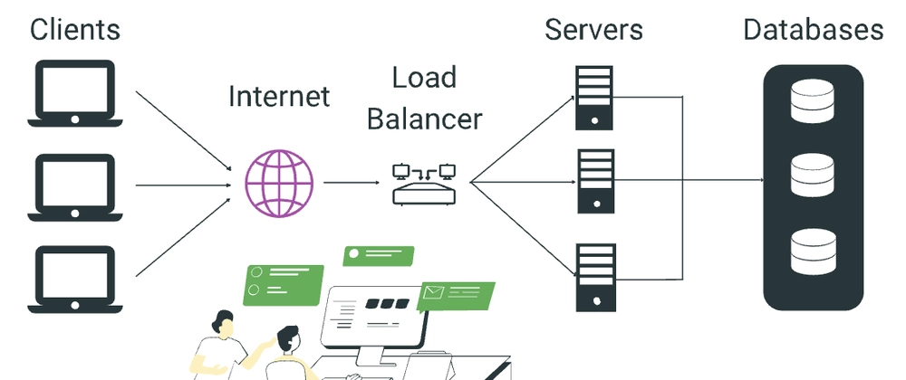
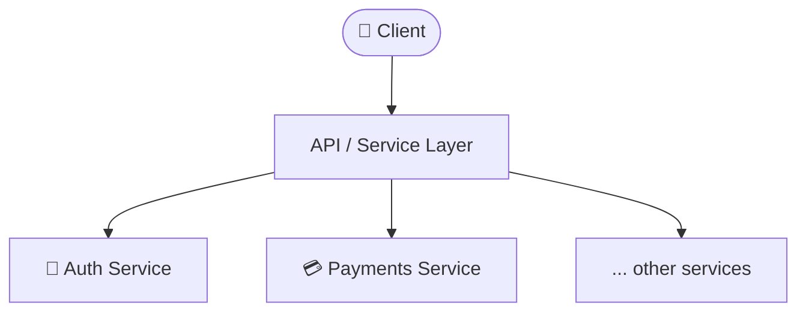
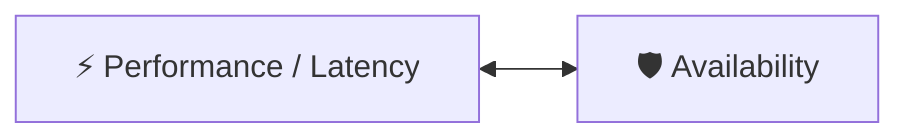

# 🧭 How to Approach a System Design Problem

A practical playbook for breaking down open-ended, real-life system design
questions ("Design Twitter", "Design a URL Shortener", etc.) into a
structured, repeatable process — plus the math and unit shorthand you need
for back-of-the-envelope estimation.

---

## 📋 Table of Contents

1. [The Big Picture](#1-the-big-picture)
2. [Step 1 — Scope the Problem](#2-step-1--scope-the-problem)
3. [Step 2 — Requirements](#3-step-2--requirements)
4. [Step 3 — Back-of-the-Envelope Estimation](#4-step-3--back-of-the-envelope-estimation)
5. [Step 4 — High-Level Design](#5-step-4--high-level-design)
6. [Step 5 — Deep Dive & Trade-offs](#6-step-5--deep-dive--trade-offs)
7. [Performance vs. Availability](#7-performance-vs-availability)
8. [Reference: Numbers & Units Cheat Sheet](#8-reference-numbers--units-cheat-sheet)

---

## 1. The Big Picture

Real system design questions are solved by **breaking down the real-life
problem and building up its core functionalities**, piece by piece — not by
jumping straight to a final architecture.

Design interviews are also **intentionally open-ended**. A prompt like:

> "Design Twitter" — 45 min

is _not_ asking you to build all of Twitter. You'll usually be told (or you
should ask) to build only a fraction of it. Treat the first few minutes as a
negotiation with your interviewer about **scope**, not a race to draw boxes.

```
Vague Prompt  →  Scoping  →  Requirements  →  Estimation  →  High-Level Design  →  Deep Dive
```

---

## 2. Step 1 — Scope the Problem

Before designing anything, agree on the boundaries of the problem with
whoever is asking (interviewer, PM, teammate):

- What's actually **in scope** for this session? (e.g., just the "post +
  timeline" flow of Twitter, not DMs, ads, and search all at once)
- What can be explicitly **deferred**?

Skipping this step is the #1 reason designs run out of time — people design
five features shallowly instead of one or two deeply.

---

## 3. Step 2 — Requirements

Split requirements into two buckets. This is the backbone of the entire
design.

### ✅ Functional Requirements

_What the user can/should be able to do._

- Things like: post a tweet, follow a user, view a timeline, like a post.
- These come straight out of the "core functionalities" you scoped in Step 1.

### ⚙️ Non-Functional Requirements

_How well the system needs to do it._

| Concern              | Question to ask                                |
| -------------------- | ---------------------------------------------- |
| **Scalability**      | How does the system behave as users/data grow? |
| **Availability**     | What % uptime is acceptable?                   |
| **Throughput (RPS)** | How many requests per second at peak?          |
| **Storage capacity** | How much data accumulates over time?           |
| **Latency**          | How fast must a single request respond?        |

> ⚠️ **Don't try to maximize every non-functional requirement at once.**
> Every one of these pulls against another (see [Section 7](#7-performance-vs-availability)).
> The goal isn't zero trade-offs — it's **carefully considered** trade-offs.

---

## 4. Step 3 — Back-of-the-Envelope Estimation

Once you know _what_ you're building, estimate _how big_ it needs to be.
This tells you whether you need one server or a thousand, one database or a
sharded fleet.

### The general recipe

1. Start from a known/assumed input (e.g., daily active users).
2. Apply a rough ratio to get daily events (e.g., "10% of DAU read per day").
3. Convert **daily → per-second** by dividing by seconds-in-a-day (≈ 86,400,
   often rounded to ~100,000 for easy mental math).
4. Round to the nearest clean power of ten.

### Worked example

```
Daily Active Users            = 100,000,000  (100M)
Read ratio                    = 10%
  →  Daily reads              = 10,000,000  (10M)

Throughput (reads/sec)
  =  Daily reads / seconds in a day
  ≈  10,000,000 / 100,000
  ≈  100 reads/sec  →  round up to design for ~1,000 reads/sec (peak buffer)
```

> 💡 **Rule of thumb:** being off by a factor of 2 is fine. Being off by a
> factor of 100,000 is not. Estimation is about landing in the right
> _ballpark_ (do you need 100 servers or 100,000?), not precision.

### Reads vs. Writes matter separately

Most systems are read-heavy or write-heavy, not balanced — always estimate
them **independently**:

```
Reads/sec   ≈ 1,000
Writes/sec  ≈ 120
```

These numbers directly drive decisions later: caching strategy, database
choice, replication factor, sharding, etc.

---

## 5. Step 4 — High-Level Design

Start with the simplest architecture that satisfies your functional
requirements, then layer in non-functional needs (scale, availability...).

### The common building blocks

Almost every system design boils down to the same core shape:

**Commonalities across almost any design:**



- A **server** (or fleet of servers) to handle requests
- A way to **route traffic** across them → a **load balancer**
- A **database** to persist state

### Load balancers

A load balancer sits in front of your server fleet and distributes incoming
traffic so no single server is overwhelmed.

> The diagram above is a _good example_ to start from — but it's the
> shallow version. A real design needs to dig deeper:
>
> - What's the **DB schema**?
> - What's the **API design**?
> - **Scalability** — horizontal or vertical?

### Horizontal vs. Vertical scaling

|            | Horizontal (scale out)            | Vertical (scale up)                 |
| ---------- | --------------------------------- | ----------------------------------- |
| Method     | Add more machines                 | Add more power to one machine       |
| Ceiling    | Very high                         | Hardware-limited                    |
| Complexity | Needs load balancing/coordination | Simple, but single point of failure |

---

## 6. Step 5 — Deep Dive & Trade-offs

Real systems are rarely a single server + single database. Once your
estimates show meaningful scale, most designs decompose into **independent
services**, each owning its own concern and often growing on its own
schedule.



Typical services that show up again and again:

- **Auth** (login, tokens, sessions)
- **Payments**
- Whatever core domain service the problem calls for (timeline, messaging,
  search, etc.)

Use your Step 3 numbers to decide **where** the pressure is, and design
that part deepest — don't spend your limited time distributing attention
evenly across every box.

---

## 7. Performance vs. Availability

These two pull in opposite directions, and almost every architectural
decision is a trade-off between them.



### Availability formula

```
Availability = (Number of successful requests) / (Total number of requests)
```

### The "nines"

| Availability               | Downtime / year | Notes                            |
| -------------------------- | --------------- | -------------------------------- |
| 99% ("two nines")          | ~3.65 days      | Rarely acceptable for production |
| 99.9% ("three nines")      | ~8.7 hours      |                                  |
| 99.99% ("four nines")      | ~52 minutes     |                                  |
| **99.999%** ("five nines") | **~5 minutes**  | Common gold-standard target      |
| 99.9999% ("six nines")     | ~31 seconds     | Extremely costly to achieve      |

> Chasing an extra "nine" of availability gets exponentially more
> expensive. Requirements might explicitly relax this — e.g. accepting
> ~10 min of downtime — in exchange for lower latency or lower cost
> elsewhere.

**Key takeaway:** you don't need _maximum_ everything. You need the
**right, deliberate trade-off** for the problem at hand — decided _with_
your interviewer/stakeholder, not assumed.

---

## 8. Reference: Numbers & Units Cheat Sheet

Fast mental-math shorthand for back-of-the-envelope estimation.

### Powers of ten (naming)

| Zeros | Value             | Name             |
| ----- | ----------------- | ---------------- |
| 0     | 1                 | One              |
| 1     | 10                | Ten              |
| 2     | 100               | Hundred          |
| 3     | 1,000             | Thousand         |
| 4     | 10,000            | Ten Thousand     |
| 5     | 100,000           | Hundred Thousand |
| 6     | 1,000,000         | Million          |
| 7     | 10,000,000        | Ten Million      |
| 8     | 100,000,000       | Hundred Million  |
| 9     | 1,000,000,000     | Billion          |
| 10    | 10,000,000,000    | Ten Billion      |
| 11    | 100,000,000,000   | Hundred Billion  |
| 12    | 1,000,000,000,000 | Trillion         |

### Time units

```
1 second        = 1,000 milliseconds (ms)
1 millisecond   = 1,000 microseconds (µs)
1 second        = 1,000,000 microseconds
1 second        = 1,000,000,000 nanoseconds (ns)

1 second  → 1 day  ≈ 86,400 seconds/day   (~100,000 for quick mental math)
```

### Storage units

```
Byte → Kilobyte → Megabyte → Gigabyte → Terabyte → Petabyte
 B   →   KB     →   MB     →   GB     →   TB     →   PB
```

Each step is ×1,000 (or ×1,024 if being precise about binary units) —
enough to convert "10M rows at 1KB each" into "~10GB of storage" in your
head during an interview.

---

## 🎯 TL;DR Checklist

- [ ] **Scope** the problem — what's in, what's explicitly out
- [ ] Split **functional** vs **non-functional** requirements
- [ ] Run **back-of-the-envelope math** — DAU → daily events → RPS, reads & writes separately
- [ ] Draw the **simplest high-level design** first (client → LB → servers → DB)
- [ ] **Deep dive** into the part your numbers say is under the most pressure
- [ ] Make **deliberate** availability/performance/scalability trade-offs — don't try to max out everything at once
