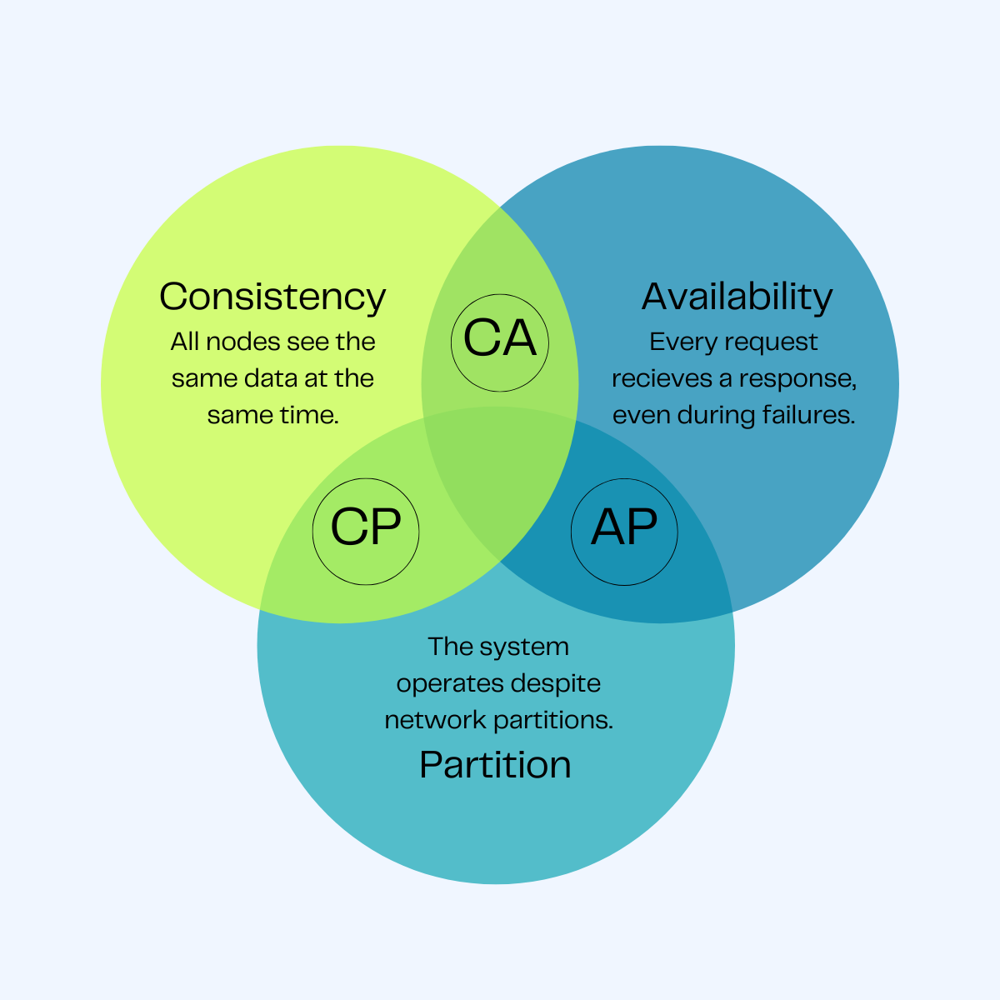
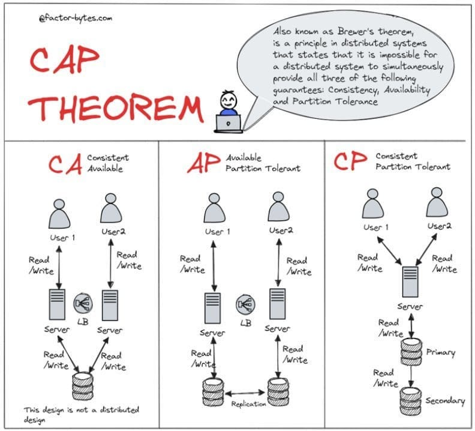

# ⚖️ The CAP Theorem

A short, practical guide to CAP — what it actually says, why it matters,
and how real systems choose sides.

---

## 📋 What CAP Stands For

In a **distributed system** (data spread across multiple nodes), you can
only fully guarantee **two out of three** of the following at the same time:

| Letter | Property                | Meaning                                                                     |
| ------ | ----------------------- | --------------------------------------------------------------------------- |
| **C**  | **Consistency**         | Every read gets the most recent write (all nodes agree, always)             |
| **A**  | **Availability**        | Every request gets a response (success or failure), no timeouts             |
| **P**  | **Partition Tolerance** | The system keeps working even if network communication between nodes breaks |

---

## 🚨 The Core Idea

> **Network partitions _will_ happen.** Cables get cut, servers lose
> connectivity, data centers go down. You don't get to opt out of **P** —
> it's a fact of distributed systems, not a choice.

So in practice, CAP isn't really "pick 2 of 3." It's:

> **When a partition happens, do you sacrifice Consistency or Availability?**

## 

## 🖼️ Visualizing a Partition

Node A and Node B can no longer talk to each other. A client reading from
**B** now faces a decision the system must make _for_ it:

- Return the **stale** value (`x = 3`) → available, but not consistent
- **Refuse** to answer until sync is restored → consistent, but not available

There is no third option — that's the whole theorem.

---

## 🌍 Real-World Examples

### CP — Consistency + Partition Tolerance (sacrifices Availability)

> Would rather **stop responding** than give you a wrong answer.

- **Banking systems** (account balance checks) — a stale balance could mean
  overdrawing an account, so the system blocks the read/write instead.
- **MongoDB** (in its default configuration) and **HBase**
- **ZooKeeper** / **etcd** (used for distributed locks/config — being wrong
  is worse than being slow)

### AP — Availability + Partition Tolerance (sacrifices Consistency)

> Would rather give you a **possibly-stale** answer than no answer.

- **Amazon DynamoDB** / **Cassandra** — a shopping cart showing an item as
  "in stock" for a few extra seconds is a fine trade-off vs. the site going
  down.
- **DNS** — always answers, even if the record hasn't fully propagated yet.
- **Social media feeds / like counts** — seeing a slightly outdated like
  count is a non-issue.

### CA — Consistency + Availability (sacrifices Partition Tolerance)

> Only really possible on a **single node** / non-distributed system —
> because once you go distributed, partitions are inevitable.

- Traditional **single-instance relational databases** (no replication).
  Not a real option once you scale horizontally.

---

## 🧭 How to Use This in a Design Interview

Ask yourself: **"Is stale data acceptable here, or is wrong data dangerous?"**

| If the data is...                                   | Lean toward                                         |
| --------------------------------------------------- | --------------------------------------------------- |
| Money, inventory counts, auth/locks                 | **CP** — correctness matters more than uptime       |
| Social feeds, view counts, recommendations, caching | **AP** — uptime matters more than perfect freshness |

> 💡 Most modern systems don't pick CP or AP globally — they pick **per
> feature**. E.g., an e-commerce app might be **CP** for checkout/payment
> but **AP** for product browsing and reviews.

---

## 🎯 TL;DR

- CAP applies **only during a network partition** — the rest of the time,
  you can often have all three.
- **P is non-negotiable** in any real distributed system — the actual
  choice is **C vs. A**.
- **CP** → refuse to answer rather than answer wrong (banking, locks).
- **AP** → always answer, even if slightly stale (social feeds, DNS, carts).
- Choose **per use case**, not once for the whole system.
