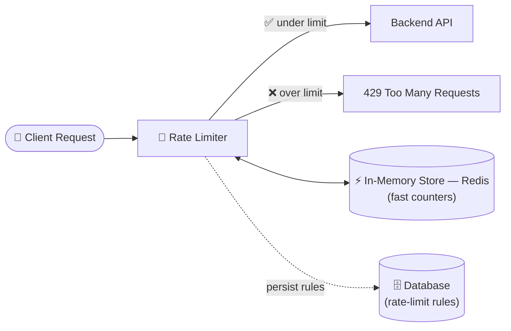

# 🚦 Rate Limiter — System Design

A guide to what a rate limiter is, why every backend needs one, and how to
design one from scratch — written to make sense whether you're technical
or not.

---

## 📋 Table of Contents

1. [What Is a Rate Limiter?](#1-what-is-a-rate-limiter)
2. [Why It Matters (Non-Technical View)](#2-why-it-matters-non-technical-view)
3. [Functional Requirements](#3-functional-requirements)
4. [Non-Functional Requirements](#4-non-functional-requirements)
5. [High-Level Design](#5-high-level-design)
6. [Algorithms — How the Counting Actually Works](#6-algorithms--how-the-counting-actually-works)
7. [Data Schema](#7-data-schema)
8. [Scaling the Rate Limiter](#8-scaling-the-rate-limiter)

---

## 1. What Is a Rate Limiter?

A **rate limiter** is a safeguard that restricts how many requests a single
source (a user, an IP address, an API key) can make in a given window of
time.

> Think of it as a bouncer at a door: not stopping people from entering
> altogether, just making sure nobody floods in all at once.

Its main jobs:

- **Security** — stop brute-force attacks (e.g., someone guessing passwords
  by trying thousands of combinations per second).
- **Fair usage / cost control** — stop one user from hogging shared
  resources or driving up infrastructure costs.
- **Stability** — protect the backend from being overwhelmed by traffic
  spikes, intentional or not.

### A real example: YouTube uploads

YouTube limits video uploads to roughly **20 per 24 hours** per account.
Why? Because every uploaded video needs to be **stored**, and storage
**costs money**. Without a limit, a bad actor (or a bug) could dump
unlimited content and blow up storage costs for no benefit to anyone.

```
More uploads allowed  →  More storage used  →  More money spent
```

A rate limiter is what keeps that equation in check.

---

## 2. Why It Matters (Non-Technical View)

Imagine a coffee shop with one barista. If ten people all shout their
orders at once, the barista freezes and nobody gets served — including the
genuinely thirsty customers. A rate limiter is the "please take a
number and one order at a time" system that keeps the shop functional for
everyone, while still politely turning away someone who tries to cut in
line 500 times in a row.

In software terms: it protects the **real, honest users** by making sure
a small number of bad actors (bots, scrapers, attackers) can't degrade or
break the service for everyone else.

---

## 3. Functional Requirements

Before designing anything, clarify **what** you're building a rate limiter
for:

- Is it for **one specific API**, or a general safeguard across **many
  services**?
- Will it need to work across **multiple servers/instances** of the same
  API? (Almost always yes — a real backend rarely runs on just one machine,
  so the limiter must count requests **globally**, not per-machine.)
- **What happens when a user hits the limit?**
  - They should be blocked from making further requests.
  - Ideally, tell them **how long to wait** (a countdown/retry timer).
  - This behavior is closely related to **throttling**.

### The correct HTTP response

When a user is rate-limited, the server should respond with:

```
HTTP 429 Too Many Requests
```

Not `500 Bad Request` — because nothing is wrong with the request itself,
and it's not a server-side failure either. `429` specifically communicates
_"you, the client, are sending too many requests."_

### What about limiting on the frontend too?

You can (and should) add a check on the **client/frontend side** to stop
requests before they're even sent. But this is a **usability nicety, not a
security control** — anyone can bypass your frontend entirely and hit your
API directly with a raw `curl` command, skipping your app altogether. The
**real** enforcement has to live on the server.

### Identifying "who" is making requests

For a general-purpose API rate limiter, the simplest identifier is the
**client's IP address**.

---

## 4. Non-Functional Requirements

| Concern          | Target                                                                                        |
| ---------------- | --------------------------------------------------------------------------------------------- |
| **Latency**      | As close to zero as possible — the rate limiter should feel _invisible_ to legitimate users.  |
| **Throughput**   | Must handle a very high volume of checks per second (every single request passes through it). |
| **Storage**      | Needs to track just enough data per user — not more.                                          |
| **Availability** | Must decide what happens if the rate limiter itself goes down.                                |

### Estimating storage

Let's say we track, per user:

- IP address → 4 bytes
- Attempt count / metadata → rest of the record

If each user's tracking record costs roughly **~132 bytes**, and we have
**1 billion users**:

```
132 bytes  ×  1,000,000,000 users  =  132 GB
```

That's a very manageable amount of data — small enough to comfortably fit
in **in-memory storage** (like Redis) rather than needing disk-based
storage, which matters a lot for latency.

### What if the rate limiter itself goes down?

This is a genuine design decision with a real trade-off — there's no
"correct" universal answer:

| Strategy        | What happens                                               | Trade-off                                                                      |
| --------------- | ---------------------------------------------------------- | ------------------------------------------------------------------------------ |
| **Fail-open**   | Allow all requests through, as if the limiter didn't exist | Legit users unaffected ✅, but attackers get a free pass too ❌                |
| **Fail-closed** | Block all requests until the limiter recovers              | Attackers blocked ✅, but _everyone_ — including real users — is locked out ❌ |

> 💡 In an interview or real design, **state this trade-off explicitly**
> rather than picking silently — the right answer depends on the product
> (a banking API might fail-closed; a social feed might fail-open).

> ⏱️ **Tip:** Spend the first 5–10 minutes of any design discussion
> pulling these requirements out of your interviewer/stakeholder before
> drawing a single box.

---

## 5. High-Level Design



- The rate limiter is the **first point of contact** for every incoming
  request — the check happens _before_ the request ever reaches the actual
  backend logic.
- Counters (how many requests a user has made) live in an **in-memory
  store like Redis** for speed — reading from a traditional database on
  every single request would be far too slow.
- The **rules themselves** (e.g., "100 requests per minute for this API")
  are persisted in a regular database and cached for fast access.

---

## 6. Algorithms — How the Counting Actually Works

### Fixed Window Algorithm

Divide time into fixed chunks (e.g., every 60-second window) and count
requests within each chunk. Once the window resets, the count resets to
zero.

```
Example: limit = 100 requests / minute

[ 0s ─────────────── 60s ][ 60s ─────────────── 120s ]
      up to 100 allowed         up to 100 allowed
```

**The flaw:** a user can send 100 requests in the _last second_ of one
window, and another 100 in the _first second_ of the next window —
technically **200 requests in ~1 second**, even though the rule says
"100/minute."

```
     Window 1 end          Window 2 start
   ...──[100 reqs]────────[100 reqs]──...
              ↑ last sec      ↑ first sec
              └─── 200 requests in ~1 second ───┘
```

In practice, this is often an acceptable trade-off — the user still can't
send another burst for another ~59 seconds, so it self-corrects. **Fixed
window is simple, reliable, and easy to implement**, with a known (small)
edge-case vulnerability.

### Sliding Window Algorithm

Instead of resetting at fixed boundaries, track the **exact timestamps** of
recent requests and continuously "slide" the window forward — dropping old
timestamps off one end as new ones are added on the other.

```
                 window continuously slides →
   ●───●──●────●───●───────●──●───●───►  time
       [ ◄────── last 60 seconds ──────► ]
```

- Requires only storing recent request timestamps (e.g., as Unix
  timestamps).
- **Much more accurate** — closes the fixed-window loophole entirely.
- **Harder to implement** and slightly more storage/compute per check.

### Fixed vs. Sliding — Quick Comparison

|                  | Fixed Window           | Sliding Window                |
| ---------------- | ---------------------- | ----------------------------- |
| Accuracy         | Has burst edge-case    | Precise                       |
| Implementation   | Simple                 | More complex                  |
| Storage          | Minimal (1 counter)    | Slightly more (timestamps)    |
| Good default for | Most general use cases | High-security / strict limits |

> Redis's **sorted sets** (`ZSET`), keyed by timestamp, are a natural fit
> for implementing a sliding window efficiently.

> There are more advanced algorithms (token bucket, leaky bucket, sliding
> window counter, etc.) — the right choice becomes fairly domain-specific
> and can be explored further depending on the exact needs.

---

## 7. Data Schema

### Counting table (Fixed Window example)

| Field          | Description                                               |
| -------------- | --------------------------------------------------------- |
| `userId` (key) | Identifies the user/IP being tracked                      |
| `count`        | Number of requests made in the current window             |
| `expire`       | TTL — Redis automatically clears it after the window ends |

### Rules table

| Field             | Type                        | Description                             |
| ----------------- | --------------------------- | --------------------------------------- |
| `id`              | string                      | Unique rule ID                          |
| `api`             | string                      | Which API/endpoint this rule applies to |
| `operation`       | string                      | The action being rate-limited           |
| `timeUnit`        | enum (`sec` / `min` / `hr`) | The window size                         |
| `requestsAllowed` | number                      | Max requests allowed in that window     |

---

## 8. Scaling the Rate Limiter

Since real systems run **multiple server instances**, the rate limiter's
storage needs to scale too — a single in-memory node won't be enough
forever.

- **Multiple Redis instances**, distributed using **consistent hashing** —
  this spreads users' counters evenly across nodes and minimizes
  redistribution when nodes are added/removed.
- Keep **latency as the top priority** — reading from an in-memory store is
  dramatically faster than reading from disk-based storage, and every
  single request in the system passes through this check.
- **Cache the rules** aggressively — they change rarely, so there's no
  reason to hit the database for them on every request.

---

## 🎯 TL;DR

- A rate limiter stops any single source from overwhelming a system —
  for **security** (brute force), **cost control** (storage/compute), and
  **stability**.
- Real enforcement must live **server-side**; frontend checks are a nice
  UX layer, not a security boundary.
- Respond with **HTTP 429**, ideally with a retry-after timer.
- Decide explicitly: **fail-open vs. fail-closed** when the limiter itself
  is down.
- **Fixed window** = simple but has a burst edge case. **Sliding window**
  = accurate but costs more to implement and store.
- Keep counters in **fast, in-memory storage** (Redis); scale it out with
  **consistent hashing** as load grows.
